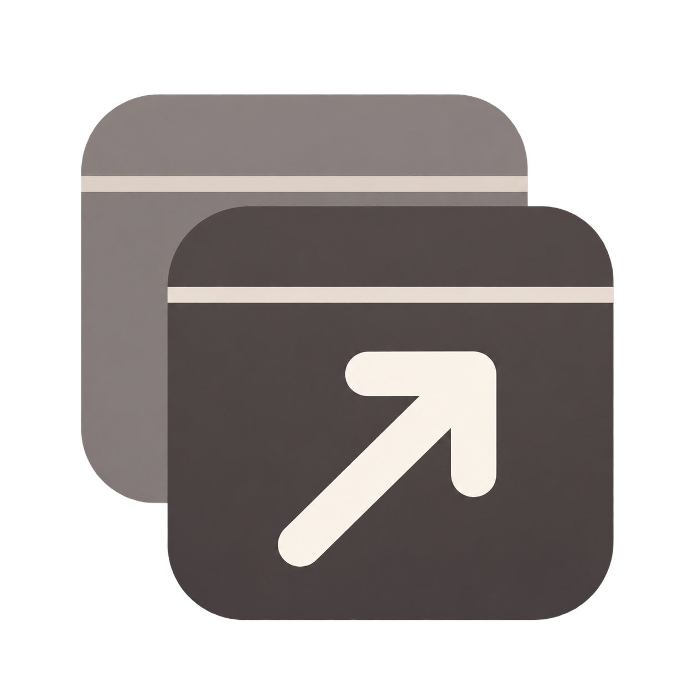
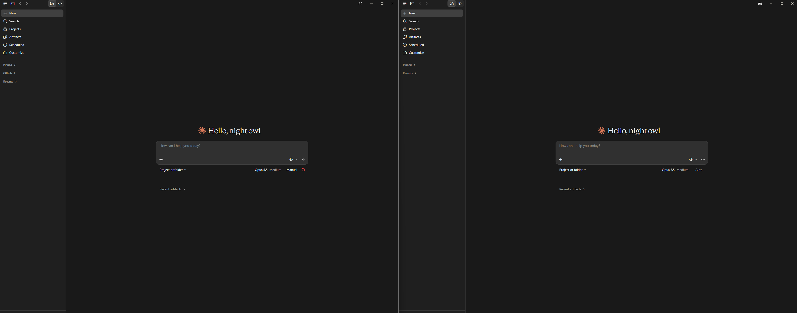
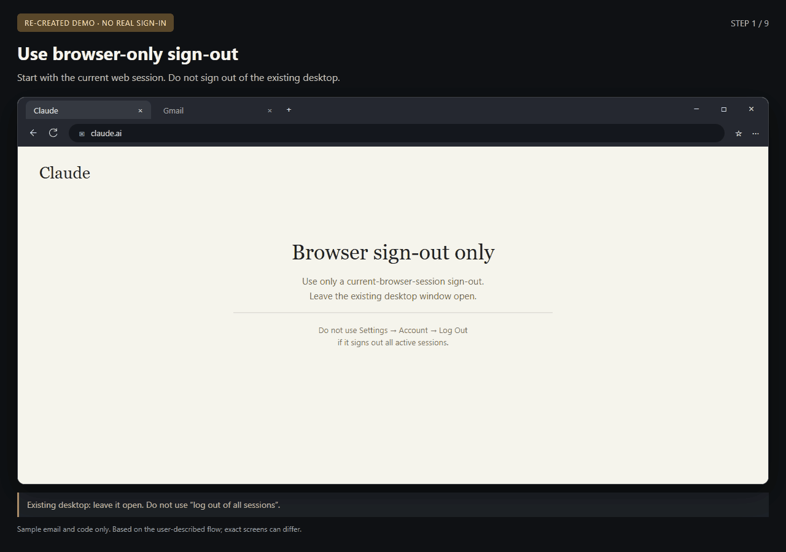

# claude-multi-launcher

<p></p>

English | [简体中文](README.zh-CN.md)

> **Unofficial community tool.** Not affiliated with, endorsed by, or sponsored by Anthropic. “Claude” is Anthropic's trademark and identifies the application this tool works with.

A simple Windows setup tool for running multiple Claude Desktop instances on one computer. Designed for **multiple Claude accounts legitimately owned by the same person**, such as work and personal accounts, it configures a separate profile for each account, with its own data, memory/configuration, workspace and temporary directories, plus a desktop shortcut. Supports English and Simplified Chinese.

Actual isolation and whether Claude Desktop uses all configured directories still require real-world verification.

## Two windows, side by side



*User-provided screenshot of two Claude Desktop windows. The step-by-step demo below uses mock data.*

## Demo: create and launch two profiles


Create `Personal`, launch it and read the first-launch notice. Then create and launch `Work`. In real use, finish signing in to the first account in the official Claude window before starting the next profile.

**This is a UI demonstration with mock backend responses.** No real Claude process, profile directories or shortcuts were created, and sign-in was not recorded. A launch status does not confirm that you are signed in. Here, “clone” means a separate profile for the same installed application, not a copied or modified Claude binary.

## Important: sign in to the new Test profile



This re-created tutorial uses separate Claude desktop, Gmail web and browser-prompt scenes, with English captions and cursor highlights. It follows the user's described flow, not a live sign-in recording or a verified copy of the current screens. All addresses and codes are placeholders; use the code from your own login attempt.

After configuring the new profile's directories:

1. Sign out of the **current Claude browser session only**. Keep the other desktop window open and do not sign out there. In the user-described flow, browser-only sign-out leaves the other desktop session unaffected; this task has not independently tested that behavior.
2. Open the newly created **Test desktop window**, enter Test's email address and request the login email / verification code.
3. Open Test's mailbox and click the link in the email for this login attempt.
4. When the browser asks **“Open Claude?”**, click **Cancel**, rather than handing the link to an arbitrary desktop window.
5. On the page showing **“Logging you in…”**, find and click **“Log in with code”** below it.
6. Copy the code that appears on that page.
7. Return to the **Test desktop window** and enter that code there. Do not enter it in the existing desktop window.
8. Complete sign-in and check that Test is using the intended account. Complete one profile's login before starting another.

**Do not choose an all-session logout.** Anthropic's [all-session logout instructions](https://support.claude.com/en/articles/10310342-how-do-i-log-out-of-all-active-sessions) describe **Settings → Account → Log Out**, which also signs out desktop apps. That is different from the browser-only step intended here. If you cannot tell which operation is offered, stop before signing out. The launcher does not sign in for you or read your email/code.

The manual-code screens in steps 4–7 are based on the user's flow and may change. Official [email sign-in guidance](https://support.claude.com/en/articles/13189465-log-in-to-your-claude-account) also describes entering a verification code on the device where sign-in was initiated, but does not confirm every screen in this Desktop-specific sequence.

## Requirements

- 64-bit Windows 10 or 11, Windows PowerShell 5.1, .NET Framework 4.8, and an official installation of Claude Desktop.
- [Microsoft WebView2 Evergreen Runtime](https://developer.microsoft.com/en-us/microsoft-edge/webview2/). The launcher embeds the existing interface in its own EXE; it does not open Edge or Chrome browser windows. WebView2 rendering processes are expected.
- No administrator privileges for the launcher. The portable package includes the compiled launcher and required SDK DLLs, not the Runtime installer or Claude. It is unsigned; Windows may show a reputation warning. Install a missing Runtime yourself from Microsoft; the launcher does not install it automatically.

## Quick start

1. Extract the **complete Windows x64 portable package** to a stable folder. Keep all accompanying files together.
2. Double-click **`claude-multi-launcher.exe`**. For a source checkout, first run `build-exe.cmd` (the first build downloads a pinned Microsoft SDK from official NuGet). `Claude Multi Launcher.cmd` is also available; it builds a missing EXE, then opens that same native window.
3. Click **New profile**, enter a name such as `Personal`, and create it. The optional location field lets you choose another root folder.
4. Click **Launch** for that profile, then sign in yourself in the official Claude window. Sign in one profile at a time.
5. Repeat for a second account you are authorized to use, such as `Work`.

The interface supports English and Chinese. Use its language button, or run this command in the extracted folder to select English:

```powershell
powershell -ExecutionPolicy Bypass -File .\claude-multi.ps1 lang en
```

To add a launcher desktop shortcut, run `create-desktop-shortcut.cmd` once after building/extracting the EXE. The launcher EXE, its desktop link and this introduction use the **original gray overlapping-window icon** above. **Profile shortcuts use the original icon extracted from your installed Claude Desktop**, refreshed on creation/rebuild; it is not distributed in this repository. Re-run the launcher shortcut script after relocating the folder. Use a profile's **··· → Rebuild shortcut** action to update an existing profile link.

`build-exe.cmd` uses the Windows C# compiler and Microsoft.Web.WebView2 SDK **1.0.4314.35**, verified against a pinned SHA-256. A portable download needs no compilation. Developers may supply an already downloaded package with `powershell -ExecutionPolicy Bypass -File tools/Build-Native.ps1 -PackagePath <sdk.nupkg>`. The result needs its accompanying DLLs, assets, `src`, `ui` and PowerShell backend; it is not a single-file application. The top title strip follows the page background instead of showing a white system bar. Closing the native window stops only its own local service, not Claude.

The WebView2 host uses its own `%LOCALAPPDATA%\claude-multi-launcher\webview2` storage. It does not reuse Edge/Chrome or Claude profile storage. The loopback random-port/random-nonce API remains in place. External navigation, popups and downloads are blocked; no native host objects or message bridge are exposed. The legacy browser server entry remains available for debugging, but normal EXE / CMD / launcher shortcuts use WebView2.

## Table controls

- Hold the dot on the left and drag a row to reorder profiles. The order is saved. You can also focus the dot and use the up/down arrow keys; press Esc during a drag to cancel it.
- **··· → Remove record** asks for confirmation, removes the profile record and the tool's shortcut, and keeps all data directories. There is no separate inline remove button.
- The separate **···** action for deleting data shows a preview and uses the Recycle Bin. Actual Recycle Bin behavior for large folders remains unverified. Files in a nonempty workspace are never deleted by the tool.
- **Scan existing clones** can discover existing launchers; importing registers their locations without copying their data. Verify detected paths before importing.

## Instance management (v23)

- The table shows **Running / Not running / Unknown**, based on matching main-process metadata in your current Windows session. It refreshes about every five seconds while the table is idle. This is not login status. Inaccessible metadata or a mismatched executable is Unknown; control is blocked when identification is uncertain.
- **Launch** waits up to 15 seconds for the matching profile process. An already running profile is focused instead of launched again. Windows may prevent foreground activation or keep Claude in the tray; the launcher reports that case rather than claiming success.
- Creation, launch, close and repair show real server progress steps. Errors identify the last active step. A failed shortcut step can leave the profile successfully saved: refresh the list and rebuild its shortcut rather than creating it again.
- **··· → Close this instance…** first requests a normal close and checks for up to five seconds. If main processes remain, a separate **Force terminate this instance** confirmation is offered. Save your work first. Force termination targets only the identified main processes from that confirmation, rechecks PID/creation time/image/arguments, and binds the process handle before acting. It never terminates all processes by application name. Background-helper cleanup remains application-dependent.
- **··· → Open MCP config…** shows `<profile data folder>\claude_desktop_config.json` and opens an existing file in Notepad after confirmation. The launcher does not read its contents, copy config, or create a missing file. Verify the location in the corresponding Claude version; editing may require restarting that instance.
- **Check and repair…** previews the detected installed app and enabled profile shortcuts. Confirmation refreshes the locally extracted icon and rebuilds eligible profile shortcuts; external same-name shortcuts are preserved and individual failures are reported. It does not install/update Claude or change explicit executable overrides. Rebuild the launcher shortcut itself with `create-desktop-shortcut.cmd`.

## Profile directories

Example defaults for a profile named `Study`:

| Item | Default location |
| --- | --- |
| Application data | `%APPDATA%\Study` |
| Claude Code configuration / memory | `%USERPROFILE%\.claude-study` |
| Workspace folder | `%USERPROFILE%\Workspaces\Study` |
| Temporary directory | `%LOCALAPPDATA%\claude-multi-launcher\tmp\Study` |
| Desktop shortcut | `Claude (Study)` |

Paths are configurable. The tool rejects duplicates, nested locations, overlaps with shared locations, and paths through symbolic links or junctions. Changing a configured path creates an empty directory if needed; it does not migrate existing files. These checks do not prove that every Desktop component honors the supplied directories.

To register the existing default application data as one profile, use `add Work -ReuseDefault`. This references the default data location rather than copying a login session; the configuration directory is still separate.

## Command line

Run commands from the extracted repository folder. `-ExecutionPolicy Bypass` applies to that PowerShell process; it does not change the system execution policy.

```powershell
powershell -ExecutionPolicy Bypass -File .\claude-multi.ps1 add Work
powershell -ExecutionPolicy Bypass -File .\claude-multi.ps1 add Study
powershell -ExecutionPolicy Bypass -File .\claude-multi.ps1 list
powershell -ExecutionPolicy Bypass -File .\claude-multi.ps1 launch Study
```

| Command | Purpose |
| --- | --- |
| `list` | List profiles |
| `add <name> [options]` | Create a profile; options include `-DataDir`, `-ConfigDir`, `-WorkspaceDir`, `-TempDir`, `-Root`, `-ReuseDefault`, `-NoShortcut`, `-Note` and `-WhatIf` |
| `launch <name>` | Launch the installed Claude app for a profile |
| `scan [<folder>]` | Scan process metadata, shortcuts, launch scripts and directory names for existing profiles |
| `import <name> -DataDir <path>` | Register an existing profile without copying its data |
| `open <name>` | Open its workspace folder in Explorer |
| `paths <name>` | Show configured paths and isolation checks |
| `set-path <name> <type> <path>` | Update a `data`, `config`, `workspace`, `temp` or `outputs` path without moving files |
| `rename <old> <new>` | Rename a profile; directory names stay unchanged |
| `remove <name>` | Confirm removal of the record and shortcut; keep data directories |
| `shortcut <name>` | Rebuild a profile shortcut |
| `lang [auto\|zh\|en]` | Show or select the interface language |

## Implementation and boundaries

The launcher locates the officially installed app and supplies `--user-data-dir`. It temporarily sets `CLAUDE_CONFIG_DIR` and `CLAUDE_CODE_TMPDIR` in its own process during launch, then restores them. It does not modify or redistribute Claude, inspect or transfer login tokens, cookies or session files, write the registry, call Anthropic APIs, or send telemetry.

The UI talks to a local server on `127.0.0.1` with a random port and a launcher-generated access token. That token is unrelated to Claude authentication. Claude's own network activity is outside this launcher's control.

Known limits:

- `~/Claude/`, including some artifacts or scheduled outputs, may be shared. The launcher does not currently isolate it.
- A `claude://` sign-in callback may reach a different profile. Complete sign-in one profile at a time; the tool does not change protocol registration.
- If your Desktop version uses a local Cowork virtual machine, concurrent profiles may conflict. The behavior is version-dependent and has not been established for every Desktop version.
- Actual use of the supplied configuration and temporary directories, window/process lifecycle, real shortcut-label mapping and large-folder Recycle Bin behavior remain subject to Windows acceptance checks.

## Unofficial status and permitted use

This is a local profile launcher, not a Claude service or a login/request proxy. Use only accounts you are authorized to use. **Do not use it to bypass usage limits, bans or other safeguards, or to share or resell accounts.** It does not display usage, reset times, account email addresses or subscription plans, and does not automatically rotate accounts.

The official materials reviewed on November 9, 2026 did not specifically authorize or specifically prohibit this Desktop multi-instance method. That does not establish either a violation or official approval. Your actual use remains subject to applicable Anthropic terms and your organization's requirements.

The project name identifies the compatible application. The launcher uses its own original gray icon. Only profile shortcut icons are extracted locally from Claude; those official icons are not distributed or used as the project's logo. Anthropic retains its trademark rights; the unofficial notice and MIT license do not grant rights to Anthropic's branding or software. See the dated [English policy notes](docs/POLICY_REVIEW.en.md) and [detailed Chinese review](docs/POLICY_REVIEW.md).

## Validation and status

v24 passed core **78/78**, features **26/26**, runtime **42/42** checks on both Windows PowerShell 5.1 and PowerShell 7. Static checks cover 15 PowerShell files, 214 UI translation keys and 14 native translation keys. The actual EXE/WebView2 passed 13 smoke checks, including the real local backend, native caption colors/controls and cleanup. Existing mock UI interaction and split-UTF-8 streaming suites also passed. These checks do not start real Claude or prove sign-in, full Desktop isolation or real Claude-window focus/close behavior.

M1 and M3 remain **pending user acceptance**. `doctor` and a complete uninstall flow are not implemented. See [current development state](docs/dev/CURRENT_STATE.md) and [test evidence](tests/evidence/v24/VALIDATION.md); internal development documents are primarily Chinese.

For development checks on Windows:

```powershell
powershell -NoProfile -ExecutionPolicy Bypass -File tests/Test-Core.ps1 -NoPause
powershell -NoProfile -ExecutionPolicy Bypass -File tests/Test-Features.ps1 -NoPause
powershell -NoProfile -ExecutionPolicy Bypass -File tests/Test-Runtime.ps1
powershell -NoProfile -ExecutionPolicy Bypass -File tests/Test-Static.ps1
python docs/dev/tools/check_docs.py
```

You can also use `pwsh`. Build the native EXE before running feature tests. Feature tests require a local Claude installation for icon comparison and create shortcuts only in a temporary sandbox; they do not start Claude. Optional UI tests require Node.js, Playwright and Edge: `node tests/Test-Ui.cjs tests/evidence/local`. Also run `node tests/Test-RuntimeUi.cjs tests/evidence/local-runtime` for the new lifecycle UI. UI actions are mocked; the latter includes a loopback mock server to test delayed streaming. The runtime PowerShell suite compiles inert test helpers with the Windows .NET C# compiler; they are temporary test fixtures, not Claude. These development dependencies are not needed to run the launcher.

## Acknowledgments

- [Zoltak-Dev/ai-multi-instance](https://github.com/Zoltak-Dev/ai-multi-instance) for the idea of running separate instances with `--user-data-dir`.
- [vodongha/claude-desktop-clone](https://github.com/vodongha/claude-desktop-clone) for documentation discussing shared configuration and local Cowork limitations.
- This project's code was written independently, without copying those projects' source code.

## License

MIT. See [LICENSE](LICENSE).

## Native window validation (v24)

Windows PowerShell 5.1 and PowerShell 7: core 78/78, features 26/26, runtime 42/42. Static checks: 15 PowerShell files, 214 UI keys and 14 native keys per language. The real EXE/WebView2 smoke test passed 13 checks, including the real backend, matching caption/body colors in both themes, caption buttons and service cleanup. See `tests/evidence/v24/VALIDATION.md`. This is pending human acceptance; no real Claude launch or sign-in was tested.

For native development checks, after building and installing Playwright: `node tests/Test-Native.cjs tests/evidence/local-native`. It temporarily enables loopback CDP only for its test child, uses isolated launcher configuration/cache and leaves Windows account environment intact. It opens/cancels creation without creating a real profile; actual creation is covered separately in the PowerShell sandbox suites.
