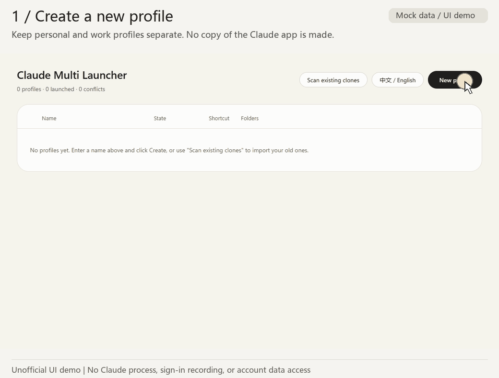

# claude-multi-launcher

English | [简体中文](README.zh-CN.md)

> **Unofficial community tool.** Not affiliated with, endorsed by, or sponsored by Anthropic. “Claude” is Anthropic's trademark and identifies the application this tool works with.

Manage Windows desktop profiles for Claude accounts you are authorized to use, such as personal and work accounts. Each profile has its own configured data, configuration, workspace and temporary directories, plus a desktop shortcut. Actual isolation depends on the Claude Desktop version and still needs real-world verification.

## Demo: create and launch two profiles



Create `Personal`, launch it and read the first-launch notice. Then create and launch `Work`. In real use, finish signing in to the first account in the official Claude window before starting the next profile.

**This is a UI demonstration with mock backend responses.** No real Claude process, profile directories or shortcuts were created, and sign-in was not recorded. A launch status does not confirm that you are signed in. Here, “clone” means a separate profile for the same installed application, not a copied or modified Claude binary.

## Requirements

- Windows 10 or 11, PowerShell 5.1 or later, and an official installation of Claude Desktop.
- Microsoft Edge, or Google Chrome as a fallback, for the launcher window.
- No administrator privileges, compilation or additional runtime packages are needed for the main `.cmd` entry point.

## Quick start

1. Extract the complete source package to a stable folder.
2. Double-click **`Claude Multi Launcher.cmd`**. Keep it together with `claude-multi-server.ps1`, `src` and `ui`.
3. Click **New profile**, enter a name such as `Personal`, and create it. The optional location field lets you choose another root folder.
4. Click **Launch** for that profile, then sign in yourself in the official Claude window. Sign in one profile at a time.
5. Repeat for a second account you are authorized to use, such as `Work`.

The interface supports English and Chinese. Use its language button, or run this command in the extracted folder to select English:

```powershell
powershell -ExecutionPolicy Bypass -File .\claude-multi.ps1 lang en
```

To add a launcher desktop shortcut, run `create-desktop-shortcut.cmd` once. It uses the icon extracted from your locally installed Claude Desktop; the repository does not include that icon. Re-run it after relocating the launcher. Use a profile's **··· → Rebuild shortcut** action to rebuild that profile's shortcut.

Optional: `build-exe.cmd` builds a small launcher executable locally using the Windows C# compiler. It starts the same launcher; compilation is not required for normal use.

## Table controls

- Hold the dot on the left and drag a row to reorder profiles. The order is saved. You can also focus the dot and use the up/down arrow keys; press Esc during a drag to cancel it.
- **··· → Remove record** asks for confirmation, removes the profile record and the tool's shortcut, and keeps all data directories. There is no separate inline remove button.
- The separate **···** action for deleting data shows a preview and uses the Recycle Bin. Actual Recycle Bin behavior for large folders remains unverified. Files in a nonempty workspace are never deleted by the tool.
- **Scan existing clones** can discover existing launchers; importing registers their locations without copying their data. Verify detected paths before importing.

## Profile directories

Example defaults for a profile named `Study`:

| Item | Default location |
| --- | --- |
| Application data | `%APPDATA%\Study` |
| Claude Code configuration / memory | `%USERPROFILE%\.claude-study` |
| Workspace folder | `%USERPROFILE%\Workspaces\Study` |
| Temporary directory | `%LOCALAPPDATA%\claude-multi-launcher\tmp\Study` |
| Desktop shortcut | `Claude (Study)` |

Paths are configurable. The tool rejects duplicates, nested locations, overlaps with shared locations, and paths through symbolic links or junctions. Changing a configured path creates an empty directory if needed; it does not migrate existing files. These checks do not prove that every Desktop component honors the supplied directories.

To register the existing default application data as one profile, use `add Work -ReuseDefault`. This references the default data location rather than copying a login session; the configuration directory is still separate.

## Command line

Run commands from the extracted repository folder. `-ExecutionPolicy Bypass` applies to that PowerShell process; it does not change the system execution policy.

```powershell
powershell -ExecutionPolicy Bypass -File .\claude-multi.ps1 add Work
powershell -ExecutionPolicy Bypass -File .\claude-multi.ps1 add Study
powershell -ExecutionPolicy Bypass -File .\claude-multi.ps1 list
powershell -ExecutionPolicy Bypass -File .\claude-multi.ps1 launch Study
```

| Command | Purpose |
| --- | --- |
| `list` | List profiles |
| `add <name> [options]` | Create a profile; options include `-DataDir`, `-ConfigDir`, `-WorkspaceDir`, `-TempDir`, `-Root`, `-ReuseDefault`, `-NoShortcut`, `-Note` and `-WhatIf` |
| `launch <name>` | Launch the installed Claude app for a profile |
| `scan [<folder>]` | Scan process metadata, shortcuts, launch scripts and directory names for existing profiles |
| `import <name> -DataDir <path>` | Register an existing profile without copying its data |
| `open <name>` | Open its workspace folder in Explorer |
| `paths <name>` | Show configured paths and isolation checks |
| `set-path <name> <type> <path>` | Update a `data`, `config`, `workspace`, `temp` or `outputs` path without moving files |
| `rename <old> <new>` | Rename a profile; directory names stay unchanged |
| `remove <name>` | Confirm removal of the record and shortcut; keep data directories |
| `shortcut <name>` | Rebuild a profile shortcut |
| `lang [auto\|zh\|en]` | Show or select the interface language |

## Implementation and boundaries

The launcher locates the officially installed app and supplies `--user-data-dir`. It temporarily sets `CLAUDE_CONFIG_DIR` and `CLAUDE_CODE_TMPDIR` in its own process during launch, then restores them. It does not modify or redistribute Claude, inspect or transfer login tokens, cookies or session files, write the registry, call Anthropic APIs, or send telemetry.

The UI talks to a local server on `127.0.0.1` with a random port and a launcher-generated access token. That token is unrelated to Claude authentication. Claude's own network activity is outside this launcher's control.

Known limits:

- `~/Claude/`, including some artifacts or scheduled outputs, may be shared. The launcher does not currently isolate it.
- A `claude://` sign-in callback may reach a different profile. Complete sign-in one profile at a time; the tool does not change protocol registration.
- If your Desktop version uses a local Cowork virtual machine, concurrent profiles may conflict. The behavior is version-dependent and has not been established for every Desktop version.
- Actual use of the supplied configuration and temporary directories, window/process lifecycle, real shortcut-label mapping and large-folder Recycle Bin behavior remain subject to Windows acceptance checks.

## Unofficial status and permitted use

This is a local profile launcher, not a Claude service or a login/request proxy. Use only accounts you are authorized to use. **Do not use it to bypass usage limits, bans or other safeguards, or to share or resell accounts.** It does not display usage, reset times, account email addresses or subscription plans, and does not automatically rotate accounts.

The official materials reviewed on November 9, 2026 did not specifically authorize or specifically prohibit this Desktop multi-instance method. That does not establish either a violation or official approval. Your actual use remains subject to applicable Anthropic terms and your organization's requirements.

The project name identifies the compatible application. Shortcut icons are extracted locally, not distributed or used as the project's logo. Anthropic retains its trademark rights; the unofficial notice and MIT license do not grant rights to Anthropic's branding or software. See the dated [English policy notes](docs/POLICY_REVIEW.en.md) and [detailed Chinese review](docs/POLICY_REVIEW.md).

## Validation and status

The v16 implementation passed core tests **78/78** and feature tests **19/19** on both Windows PowerShell 5.1 and PowerShell 7, plus static checks and Playwright + Edge mock UI checks. v19 adds English documentation and an English demo; application code and existing tests are unchanged. These are not tests of real Claude sign-in or full Desktop isolation.

M1 and M3 remain **pending user acceptance**. `doctor` and a complete uninstall flow are not implemented. See [current development state](docs/dev/CURRENT_STATE.md) and [test evidence](tests/evidence/v16/VALIDATION.md); internal development documents are primarily Chinese.

For development checks on Windows:

```powershell
powershell -NoProfile -ExecutionPolicy Bypass -File tests/Test-Core.ps1 -NoPause
powershell -NoProfile -ExecutionPolicy Bypass -File tests/Test-Features.ps1 -NoPause
powershell -NoProfile -ExecutionPolicy Bypass -File tests/Test-Static.ps1
python docs/dev/tools/check_docs.py
```

You can also use `pwsh`. Feature tests require a local Claude installation for icon comparison and create shortcuts only in a temporary sandbox; they do not start Claude. Optional UI tests require Node.js, Playwright and Edge: `node tests/Test-Ui.cjs tests/evidence/local`. All UI requests are mocked. These development dependencies are not needed to run the launcher.

## Acknowledgments

- [Zoltak-Dev/ai-multi-instance](https://github.com/Zoltak-Dev/ai-multi-instance) for the idea of running separate instances with `--user-data-dir`.
- [vodongha/claude-desktop-clone](https://github.com/vodongha/claude-desktop-clone) for documentation discussing shared configuration and local Cowork limitations.
- This project's code was written independently, without copying those projects' source code.

## License

MIT. See [LICENSE](LICENSE).
