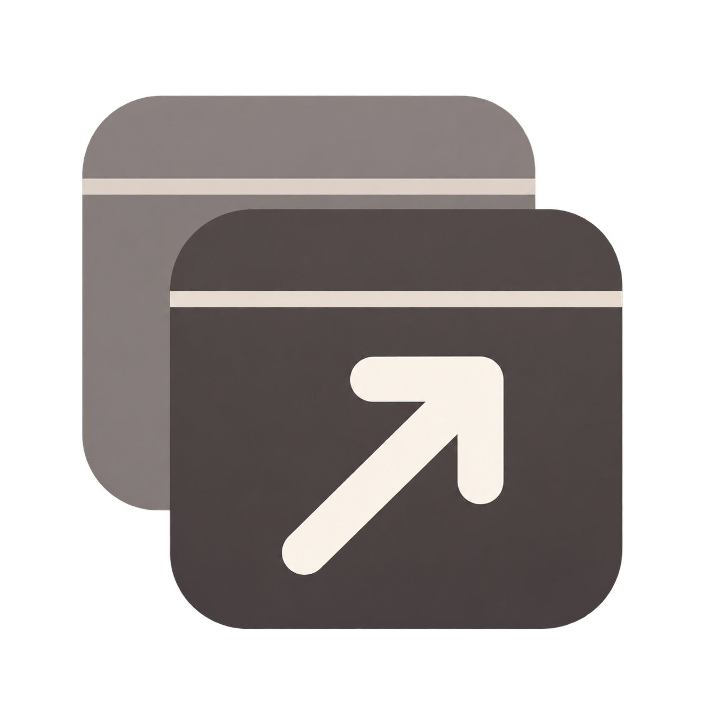
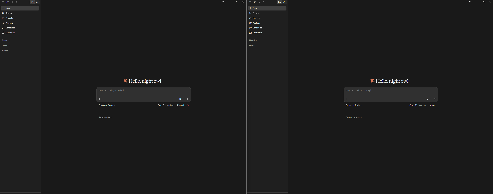
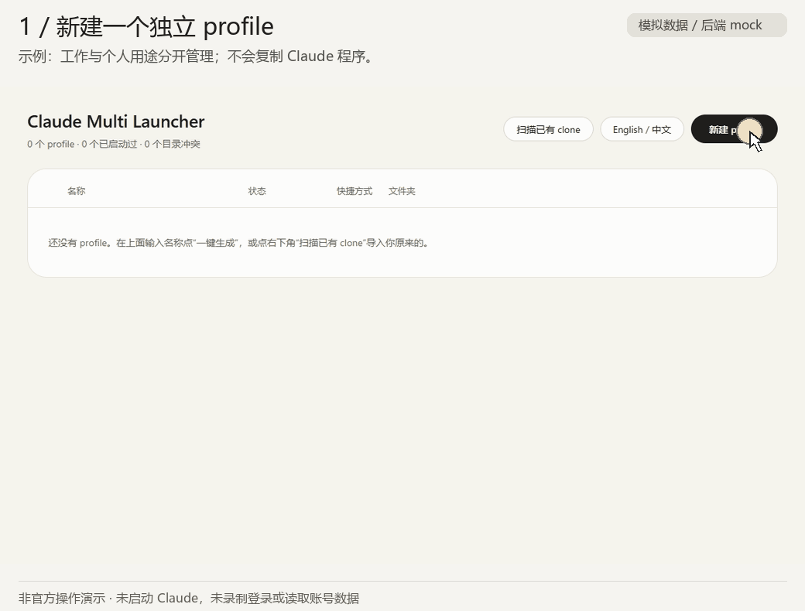
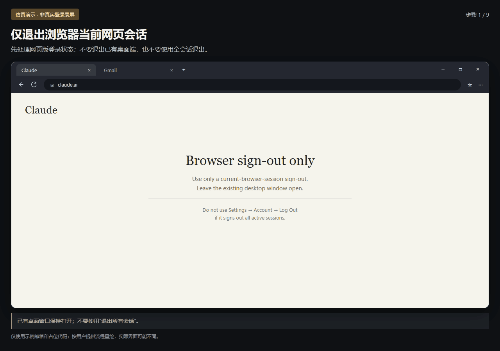

# claude-multi-launcher

<p></p>

[English](README.md) | 简体中文

> **非官方社区工具。** 由社区独立开发，与 Anthropic 无关联，不代表其官方产品或认可。"Claude" 是 Anthropic 的商标，这里仅用于说明本工具兼容的对象。
> *Unofficial community tool. Not affiliated with, endorsed by, or sponsored by Anthropic. "Claude" is a trademark of Anthropic and is used here only to describe what this tool works with.*

一个简单的 Windows 配置工具，让你在一台电脑上同时运行多个 Claude 桌面端。面向**同一个人合法拥有的多个 Claude 账号**（例如工作号和个人号），为每个账号配置独立的 profile，以及各自的数据、记忆、工作和临时目录与桌面快捷方式。支持中英双语。

- 设计文档：[`docs/design/DESIGN.md`](docs/design/DESIGN.md)
- 开发记录入口：[`docs/dev/README.md`](docs/dev/README.md)
- 当前进度：M1 核心命令行、M3 图形界面 · 待验收


## 它做什么，不做什么

**做：** 以官方安装的 Claude 桌面版为准，附加 Chromium 的标准参数 `--user-data-dir`，并只对启动出来的子进程设置 `CLAUDE_CONFIG_DIR` 与 `CLAUDE_CODE_TMPDIR`。

**不做（也不会做）：**
- 不修改、重新打包或分发 Claude 程序；本仓库不包含 Claude 图标。profile 快捷方式沿用本机 Claude Desktop 图标，仅在用户电脑上提取，不随仓库分发；启动器使用原创灰色双窗口图标。
- 不读取、不解析、不复制、不上传任何登录令牌、Cookie 或会话文件，也不在 profile 之间搬运登录状态。
- 不写注册表，不改安全设置，不需要管理员权限，仅使用本机回环服务，不调用 Anthropic 远程接口或发送遥测；Claude 本体的联网行为不由本工具控制。
- 不提供切换第三方 API、规避用量限制、共享或转售账号的功能。请遵守 Anthropic 的使用条款；不得通过账号轮换规避限制、封禁或保护措施；额度规则由 Anthropic 决定，本工具不作额度相互独立的承诺。


## 双窗口运行画面



*用户提供的 Claude Desktop 双窗口截图。下方操作动图使用模拟数据。*


## 动图：创建并启动两个 profile



演示顺序：新建 `Personal` → 创建并启动 → 阅读首次启动提示 → 新建并启动 `Work`。实际使用时，先在官方 Claude 窗口完成一个账号的登录，再启动下一个。

动图使用真实启动器界面和模拟后端响应，没有启动 Claude 或录制登录；“已启动过”不代表已登录。这里的 clone 是为同一个官方程序指定不同的数据目录，不是复制或修改 Claude 程序。实际隔离效果仍需按版本验证。


## 关键登录步骤：把新账号登录到 Test 窗口



此教程按用户提供的流程，分别重绘 Claude 桌面端、Gmail 网页版和浏览器提示，配有中文字幕与鼠标高亮。它是仿真教程，不是真实登录录屏，也未验证与当前界面完全一致。邮箱和代码均为占位内容；实际使用你本次登录页显示的代码。

配置好新 profile 的目录后：

1. 先退出 **浏览器当前 Claude 网页会话**，保留另一个桌面窗口，不要在那个桌面窗口里退出。按用户描述，普通网页退出不影响另一个桌面端；本轮未独立实测该行为，不对所有退出方式作保证。
2. 打开新克隆的 **Test 桌面窗口**，输入 Test 的邮箱地址，点击发送登录邮件 / 验证码。
3. 进入 Test 的邮箱，点击这次登录对应的邮件链接。
4. 浏览器弹出类似 **“要打开 Claude 吗？”** 的提示时，**点“取消”**，不要让浏览器自动把链接交给其他桌面窗口。
5. 此时网页显示 **“Logging you in…”**，点击下面的 **“Log in with code”**。
6. 复制网页显示的代码。
7. 切回 **Test 桌面窗口**，把代码输入那里；不要输入到已有桌面窗口。
8. 完成登录，确认 Test 使用的是目标账号。一个 profile 登录完成后，再进行下一个。

**不要使用“退出所有会话”。** 官方[全会话退出说明](https://support.claude.com/en/articles/10310342-how-do-i-log-out-of-all-active-sessions)中的 **Settings → Account → Log Out** 会同时退出桌面端，与本教程所指的当前网页会话退出不同。无法确认退出范围时，先不要操作。多开器不会代登录，也不会读取邮箱或代码。

第 4–7 步的具体画面以用户提供的流程为依据，可能随版本改变。官方[邮箱登录说明](https://support.claude.com/en/articles/13189465-log-in-to-your-claude-account)也介绍了在发起登录的设备上输入验证码，但不能据此视为已验证本教程的每个桌面端画面。


## 每个 profile 的「四件套」

以名称 `Study` 为例（`%…%` 会在你的电脑上展开，工具不会写死用户名）：

| 项目 | 默认位置 |
| --- | --- |
| 登录数据 | `%APPDATA%\Study` |
| 工作区记忆（Claude Code 配置目录） | `%USERPROFILE%\.claude-study` |
| 专用文件夹 | `%USERPROFILE%\Workspaces\Study`（已存在则沿用，工具只建空目录，**绝不删除其中任何文件**） |
| 桌面快捷方式 | `Claude (Study)` |

另外每个 profile 还有一个**临时目录**，默认在 `%LOCALAPPDATA%\claude-multi-launcher\tmp\Study`。所有位置都可以指定，但必须互相独立：工具会拒绝重复、互相嵌套、与共用位置（如 `~/.claude`、`~/Claude`、默认应用数据）重叠，或经过符号链接/目录联接的位置。


## 要求

- Windows 10/11，PowerShell 5.1 或更高（系统自带），已从官方渠道安装 Claude 桌面版。
- 不需要管理员权限，不需要安装任何依赖。


## 快速开始（图形界面）

完整解压 **Windows x64 便携版**到稳定目录，直接双击 **`claude-multi-launcher.exe`**。保留全部配套文件。它用 **WebView2 内嵌窗口**显示原有界面，不打开 Edge / Chrome 浏览器窗口；仍会运行 WebView2 渲染进程。顶部标题栏与页面背景同色，支持拖动、调整大小、最小化、最大化和关闭。

需要 64 位 Windows 10/11、Windows PowerShell 5.1、.NET Framework 4.8 及 [微软 WebView2 Evergreen Runtime](https://developer.microsoft.com/en-us/microsoft-edge/webview2/)。便携包包含自编译的启动器和 SDK DLL，不含运行时安装程序或 Claude。缺少运行时会提示，请自行从微软安装；启动器不自动安装、不改注册表。程序未签名，Windows 可能显示信誉提示。

窗口背后仍是只监听 `127.0.0.1` 的随机端口/随机令牌服务；关闭窗口只退出自己启动的本地服务，不结束 Claude。WebView2 使用独立的 `%LOCALAPPDATA%\claude-multi-launcher\webview2` 缓存，不复用 Edge、Chrome 或 Claude profile；禁止外部导航、弹窗和下载，不暴露原生对象或消息桥。

想要桌面上有个固定图标：先运行一次 `create-desktop-shortcut.cmd`，它会在桌面放一个「Claude Multi Launcher」图标，之后双击该图标打开即可。

如果下载的是 GitHub 源码：先运行 `build-exe.cmd`。首次编译会从微软官方 NuGet 下载固定版本的 WebView2 SDK（1.0.4314.35，校验 SHA-256），再用 Windows 自带的 C# 编译器生成 EXE；不安装运行时。已有 SDK 可通过 `tools/Build-Native.ps1 -PackagePath <sdk.nupkg>` 离线编译。`Claude Multi Launcher.cmd` 也可使用：缺少 EXE 时先编译，再打开同一个内嵌窗口。EXE 需要配套 DLL、assets、src、ui 和后端脚本，不是单文件程序。便携版无需编译。旧浏览器服务入口仅作开发调试保留。

**v16 表格操作：**最左侧圆点可按住上下拖动排序，松手后保存，下次打开保留；聚焦圆点后也可使用上下方向键，拖动中按 Esc 取消。“··· → 删除记录”会先确认，保留所有数据目录；每行不再单独显示删除按钮；“连数据一起删除”仍在“···”菜单中。

**启动器 EXE、启动器桌面快捷方式和 README 使用原创灰色双窗口图标。每个 profile 快捷方式仍使用本机 Claude Desktop 的原图标**，新建/重建时重新提取，不做灰度修改，也不随仓库分发。编译或解压 EXE 后运行 `create-desktop-shortcut.cmd`，可将旧启动器快捷方式迁移到新 EXE；档案图标用“··· → 重建快捷方式”更新。移动工具目录后再重建启动器快捷方式。


## 快速开始（命令行）

在仓库目录打开 PowerShell。Windows 默认的执行策略不允许运行脚本，可以只对这一条命令放行（这是进程级的临时参数，不会改变系统设置）：

```powershell
powershell -ExecutionPolicy Bypass -File .\claude-multi.ps1 add Work
powershell -ExecutionPolicy Bypass -File .\claude-multi.ps1 add Study
powershell -ExecutionPolicy Bypass -File .\claude-multi.ps1 list
powershell -ExecutionPolicy Bypass -File .\claude-multi.ps1 launch Study
```

之后直接双击桌面上的 `Claude (Study)` 即可。**首次登录时请一次只登一个 profile**，完成后再登下一个，避免登录回调落到别的窗口。

沿用你已经登录的默认账号作为其中一个 profile：`add Work -ReuseDefault`（只沿用登录数据；工作区记忆仍然是独立的新目录）。


## 命令

| 命令 | 说明 |
| --- | --- |
| `list` | 列出所有 profile |
| `add <名称> [选项]` | 创建 profile。选项：`-DataDir` `-ConfigDir` `-WorkspaceDir` `-TempDir` `-Root` `-ReuseDefault` `-NoShortcut` `-Note` `-WhatIf` |
| `launch <名称>` | 启动 |
| `scan [<文件夹>]` | 只读扫描这台电脑上已有的 Claude clone（运行进程、桌面与开始菜单的快捷方式和启动脚本、数据文件夹）；可再指定一个你存放 clone 的文件夹 |
| `import <名称> -DataDir <路径>` | 把已有 clone 登记为 profile，只登记，不复制、不改动原目录里的任何文件 |
| `open <名称>` | 在资源管理器中打开专用文件夹 |
| `paths <名称>` | 查看各位置与独立性检查结果 |
| `set-path <名称> <类型> <路径>` | 修改某个位置。类型：`data` `config` `workspace` `temp` `outputs`。只更新配置并创建空目录，**不移动旧数据** |
| `rename <旧名称> <新名称>` | 改名（各目录名称不变） |
| `remove <名称>` | 删除 profile 记录和桌面快捷方式，先预览再确认；数据目录一律保留 |
| `shortcut <名称>` | 重新创建桌面快捷方式 |
| `lang [auto\|zh\|en]` | 查看或设置界面语言 |

## 诚实说明：能做到与做不到

**已实现：** 管理多个 profile 的目录、快捷方式和启动参数；表格排序可保存。多个实例的实际隔离效果依赖 Claude Desktop 版本，尚未证明所有功能均独立。

**做不到或有条件：**
1. **`~/Claude/`（Artifacts 与计划任务输出）很可能由多个 profile 共用**，本工具目前无法隔离，只会提示。
2. **`claude://` 登录回调可能落到别的 profile**：登录时一次只登一个。本工具不会去改系统的协议注册，只检测并说明。
3. **如果你的版本仍有本地 Cowork，它依赖整机唯一的虚拟机，同一时间可能只能一个 profile 使用。** 如果你的版本是统一版 Claude、任务只在云端运行，这一条不适用。
4. 以上行为依赖 Claude 桌面版本身，更新后可能变化。

## 实例管理（v23）

- 表格显示**运行中／未运行／状态未知**，依据当前 Windows 会话中匹配的主进程元数据，表格空闲时约每 5 秒刷新。这不是登录状态。权限不足、程序路径不符时显示未知；不能可靠识别时拒绝控制。
- “启动”发送请求后，最多等待 15 秒检查对应档案进程；已经运行则尝试显示窗口，不重复启动。Windows 前台限制或 Claude 驻留托盘时可能无法聚焦，会明确提示。
- 新建、启动、关闭、修复显示服务器实时步骤，失败指出当前步骤。新建时若快捷方式失败，档案可能已经保存，请刷新列表后重建快捷方式，不要重复新建。
- **“··· → 关闭此实例…”**先尝试正常关闭，最多等待 5 秒。主进程仍在时才提供单独的“强制结束此实例”确认，请先保存工作。强制结束只针对本次确认的主进程，再核对 PID、创建时间、程序路径和参数，并绑定进程句柄；不会按程序名结束所有 Claude。后台辅助进程的清理由应用自身决定。
- **“··· → 打开 MCP 配置…”**展示 `<此档案的数据目录>\claude_desktop_config.json`，确认后用记事本打开已有文件。工具不读取内容、不复制配置、不创建缺失文件。请在对应版本 Claude 中核对实际路径，编辑后可能需要重启此实例。
- **“检查与修复…”**预览检测到的本机 Claude 和已启用的档案快捷方式；确认后刷新本机提取的图标、重建合适的快捷方式，保护同名外部快捷方式并逐项报告失败。不下载或更新 Claude，不自动改显式程序路径配置；启动器本身的快捷方式仍用 `create-desktop-shortcut.cmd` 重建。

## 现状

v24 在 Windows PowerShell 5.1 / PowerShell 7 均通过核心 78/78、特性 26/26、运行管理 42/42；静态 15 文件、214 个 UI 键及 14 个原生窗口键一致。真实 EXE/WebView2 的 13 项、实际本地 HTTP 进度、自建无业务测试进程及原浏览器 mock 回归均通过。未启动真实 Claude，真实窗口聚焦/关闭、登录、隔离、回收站和生命周期仍待实机验收；M1 / M3 待验收。`doctor` 与完整卸载仍未实现。


## 开发验证

在 Windows 仓库根目录运行（临时沙箱，不操作真实 profile）：

```powershell
powershell -NoProfile -ExecutionPolicy Bypass -File tests/Test-Core.ps1 -NoPause
powershell -NoProfile -ExecutionPolicy Bypass -File tests/Test-Features.ps1 -NoPause
powershell -NoProfile -ExecutionPolicy Bypass -File tests/Test-Runtime.ps1
powershell -NoProfile -ExecutionPolicy Bypass -File tests/Test-Static.ps1
python docs/dev/tools/check_docs.py
```

也可用 `pwsh` 运行上述 PowerShell 测试。特性测试需要本机已安装 Claude，以比较图标并在临时目录生成 `.lnk`，不会启动 Claude。可选 UI 测试需要 Node.js、Playwright 和 Edge：`node tests/Test-Ui.cjs tests/evidence/local`；另运行 `node tests/Test-RuntimeUi.cjs tests/evidence/local-runtime` 验证新操作和实时分块进度；UI 操作为 mock。运行管理 PowerShell 自测使用系统 .NET C# 编译器生成临时无业务测试进程，不是 Claude。运行启动器本身不需要这些开发依赖。

## 非官方声明与使用边界

本项目是用于管理本人获授权账号的非官方本地启动工具，不提供 Claude 服务，不代办登录或中转请求。**不得用于绕过用量限制、封禁或其他保护措施，也不得用于共享或转售账号。**

截至 2026-11-09 查阅的官方资料，尚未找到针对这种 Desktop 本地多实例启动方式的明确许可或专门禁令；不能据此直接认定违规，也不代表已获官方认可。实际使用仍须遵守适用的 Anthropic 条款及所在组织的要求。

“Claude”名称用于说明兼容对象；启动器使用原创灰色双窗口 Logo；只有 profile 快捷方式复用用户本机 Claude 原图标，仓库不附带官方图标，也不将其用作项目 Logo。商标权属于 Anthropic，非官方声明与 MIT 许可证不构成品牌授权。依据、适用范围与尚未确认事项见 [政策说明](docs/POLICY_REVIEW.md)。

## 致谢

- 用 `--user-data-dir` 并行运行多个实例的做法，来自 [Zoltak-Dev/ai-multi-instance](https://github.com/Zoltak-Dev/ai-multi-instance)。
- [vodongha/claude-desktop-clone](https://github.com/vodongha/claude-desktop-clone) 的说明文档让我们了解了 Cowork 虚拟机与共用 `~/.claude` 的限制。
- 本项目的代码全部为重新编写，没有复制以上项目的源码。

## 许可证

MIT，见 [LICENSE](LICENSE)。

---

## English summary

Manage desktop profiles for accounts you are authorized to use (e.g. work and personal). The launcher supplies `--user-data-dir`, `CLAUDE_CONFIG_DIR` and `CLAUDE_CODE_TMPDIR`; actual Desktop isolation is version-dependent and remains unverified. It does not modify or redistribute Claude, inspect credentials, write the registry, call Anthropic APIs, or send telemetry. Its UI communicates with a loopback-only local server. Do not use account rotation to evade restrictions or bans. This is an unofficial local launcher, not an Anthropic product or endorsement. The reviewed materials neither specifically authorize nor specifically prohibit this Desktop multi-instance method; this is not a guarantee of compliance. The Claude name identifies the compatible app, and the launcher has its own original gray icon; profile shortcut icons are extracted locally rather than distributed or used as the project logo. Anthropic retains its trademark rights. See the dated [policy notes](docs/POLICY_REVIEW.md). Run `powershell -ExecutionPolicy Bypass -File .\claude-multi.ps1 help` for usage. Interface language follows your system (`lang auto|zh|en`). Known limits: `~/Claude/` is likely shared between profiles; `claude://` sign-in callbacks may land in another profile, so sign in one profile at a time; local Cowork (if your version still has it) may allow only one profile at a time.

## v24 内嵌窗口验证

双 PowerShell：核心各 78/78、特性各 26/26、运行管理各 42/42；静态 15 个 PowerShell 文件、214 个 UI 翻译键和 14 个原生窗口键一致。真实 EXE/WebView2 冒烟 13 项通过，含真实后端、中英切换、深浅标题栏同色、原生窗口按钮和服务退出。详情见 `tests/evidence/v24/VALIDATION.md`。机器检查不等于人工验收，未启动或登录真实 Claude。

开发时可在编译并安装 Playwright 后运行 `node tests/Test-Native.cjs tests/evidence/local-native`。仅测试子进程临时启用本机 CDP；配置/缓存独立，保留真实 Windows 环境变量。测试只打开/取消新建窗口，不创建实际 profile；目录创建由 PowerShell 沙箱另测。首次运行特性测试前也需先编译 EXE。
