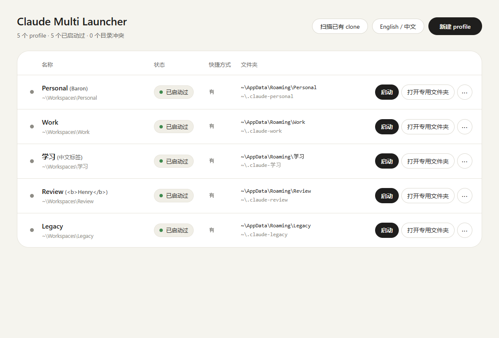

# claude-multi-launcher

[English](README.md) | 简体中文

> **非官方社区工具。** 由社区独立开发，与 Anthropic 无关联，不代表其官方产品或认可。"Claude" 是 Anthropic 的商标，这里仅用于说明本工具兼容的对象。
> *Unofficial community tool. Not affiliated with, endorsed by, or sponsored by Anthropic. "Claude" is a trademark of Anthropic and is used here only to describe what this tool works with.*

在 Windows 上，让**同一个人合法拥有的多个 Claude 账号**（例如工作号和个人号）各用一套独立的 profile，并行运行 Claude 桌面版。每个 profile 配置独立的数据、记忆、工作和临时目录及桌面快捷方式；桌面版是否采用全部目录仍需实机验证。支持中英双语。

- 设计文档：[`docs/design/DESIGN.md`](docs/design/DESIGN.md)
- 开发记录入口：[`docs/dev/README.md`](docs/dev/README.md)
- 当前进度：M1 核心命令行、M3 图形界面 · 待验收

## 它做什么，不做什么

**做：** 以官方安装的 Claude 桌面版为准，附加 Chromium 的标准参数 `--user-data-dir`，并只对启动出来的子进程设置 `CLAUDE_CONFIG_DIR` 与 `CLAUDE_CODE_TMPDIR`。

**不做（也不会做）：**
- 不修改、重新打包或分发 Claude 程序；本仓库不包含 Claude 图标。快捷方式沿用本机已安装的 Claude Desktop 图标，仅在用户电脑上提取，不随仓库分发。
- 不读取、不解析、不复制、不上传任何登录令牌、Cookie 或会话文件，也不在 profile 之间搬运登录状态。
- 不写注册表，不改安全设置，不需要管理员权限，仅使用本机回环服务，不调用 Anthropic 远程接口或发送遥测；Claude 本体的联网行为不由本工具控制。
- 不提供切换第三方 API、规避用量限制、共享或转售账号的功能。请遵守 Anthropic 的使用条款；不得通过账号轮换规避限制、封禁或保护措施；额度规则由 Anthropic 决定，本工具不作额度相互独立的承诺。

## 双窗口运行画面


*用户提供的 Claude Desktop 双窗口截图。下方操作动图使用模拟数据。*

## 动图：创建并启动两个 profile


演示顺序：新建 `Personal` → 创建并启动 → 阅读首次启动提示 → 新建并启动 `Work`。实际使用时，先在官方 Claude 窗口完成一个账号的登录，再启动下一个。

动图使用真实启动器界面和模拟后端响应，没有启动 Claude 或录制登录；“已启动过”不代表已登录。这里的 clone 是为同一个官方程序指定不同的数据目录，不是复制或修改 Claude 程序。实际隔离效果仍需按版本验证。

## 每个 profile 的「四件套」

以名称 `Study` 为例（`%…%` 会在你的电脑上展开，工具不会写死用户名）：

| 项目 | 默认位置 |
| --- | --- |
| 登录数据 | `%APPDATA%\Study` |
| 工作区记忆（Claude Code 配置目录） | `%USERPROFILE%\.claude-study` |
| 专用文件夹 | `%USERPROFILE%\Workspaces\Study`（已存在则沿用，工具只建空目录，**绝不删除其中任何文件**） |
| 桌面快捷方式 | `Claude (Study)` |

另外每个 profile 还有一个**临时目录**，默认在 `%LOCALAPPDATA%\claude-multi-launcher\tmp\Study`。所有位置都可以指定，但必须互相独立：工具会拒绝重复、互相嵌套、与共用位置（如 `~/.claude`、`~/Claude`、默认应用数据）重叠，或经过符号链接/目录联接的位置。

## 要求

- Windows 10/11，PowerShell 5.1 或更高（系统自带），已从官方渠道安装 Claude 桌面版。
- 不需要管理员权限，不需要安装任何依赖。

## 快速开始（图形界面）

直接双击 **`Claude Multi Launcher.cmd`** 即可，不用编译、不下载、不安装任何东西。它会用系统自带的 Edge（没有就用 Chrome）打开一个独立的应用窗口：在里面新建 profile、扫描并导入已有的 clone、启动、打开文件夹、查看路径、重建快捷方式、删除记录。窗口背后是只监听本机 `127.0.0.1` 的小服务（随机端口加随机令牌），关闭窗口后服务自动退出。这个 `.cmd` 要和 `claude-multi-server.ps1`、`src`、`ui` 文件夹放在一起。

想要桌面上有个固定图标：先运行一次 `create-desktop-shortcut.cmd`，它会在桌面放一个「Claude Multi Launcher」图标，之后双击该图标打开即可。

（可选）如果你更想要一个真正的 `.exe`：双击 `build-exe.cmd`，它会用 Windows 自带的 C# 编译器在本机生成 `claude-multi-launcher.exe`（同样不下载、不安装）。exe 和上面的 `.cmd` 作用相同，只是双击时不会有命令行窗口一闪而过。

**v16 表格操作：**最左侧圆点可按住上下拖动排序，松手后保存，下次打开保留；聚焦圆点后也可使用上下方向键，拖动中按 Esc 取消。“··· → 删除记录”会先确认，保留所有数据目录；每行不再单独显示删除按钮；“连数据一起删除”仍在“···”菜单中。

桌面图标使用本机已安装的 Claude Desktop 图标。更新后重新运行 `create-desktop-shortcut.cmd`，即可重建 launcher 图标；档案图标用“··· → 重建快捷方式”更新。不要移动解压后的工具目录，否则应再重建快捷方式。交付包不包含 Claude 图标。

## 快速开始（命令行）

在仓库目录打开 PowerShell。Windows 默认的执行策略不允许运行脚本，可以只对这一条命令放行（这是进程级的临时参数，不会改变系统设置）：

```powershell
powershell -ExecutionPolicy Bypass -File .\claude-multi.ps1 add Work
powershell -ExecutionPolicy Bypass -File .\claude-multi.ps1 add Study
powershell -ExecutionPolicy Bypass -File .\claude-multi.ps1 list
powershell -ExecutionPolicy Bypass -File .\claude-multi.ps1 launch Study
```

之后直接双击桌面上的 `Claude (Study)` 即可。**首次登录时请一次只登一个 profile**，完成后再登下一个，避免登录回调落到别的窗口。

沿用你已经登录的默认账号作为其中一个 profile：`add Work -ReuseDefault`（只沿用登录数据；工作区记忆仍然是独立的新目录）。

## 命令

| 命令 | 说明 |
| --- | --- |
| `list` | 列出所有 profile |
| `add <名称> [选项]` | 创建 profile。选项：`-DataDir` `-ConfigDir` `-WorkspaceDir` `-TempDir` `-Root` `-ReuseDefault` `-NoShortcut` `-Note` `-WhatIf` |
| `launch <名称>` | 启动 |
| `scan [<文件夹>]` | 只读扫描这台电脑上已有的 Claude clone（运行进程、桌面与开始菜单的快捷方式和启动脚本、数据文件夹）；可再指定一个你存放 clone 的文件夹 |
| `import <名称> -DataDir <路径>` | 把已有 clone 登记为 profile，只登记，不复制、不改动原目录里的任何文件 |
| `open <名称>` | 在资源管理器中打开专用文件夹 |
| `paths <名称>` | 查看各位置与独立性检查结果 |
| `set-path <名称> <类型> <路径>` | 修改某个位置。类型：`data` `config` `workspace` `temp` `outputs`。只更新配置并创建空目录，**不移动旧数据** |
| `rename <旧名称> <新名称>` | 改名（各目录名称不变） |
| `remove <名称>` | 删除 profile 记录和桌面快捷方式，先预览再确认；数据目录一律保留 |
| `shortcut <名称>` | 重新创建桌面快捷方式 |
| `lang [auto\|zh\|en]` | 查看或设置界面语言 |

## 诚实说明：能做到与做不到

**已实现：** 管理多个 profile 的目录、快捷方式和启动参数；表格排序可保存。多个实例的实际隔离效果依赖 Claude Desktop 版本，尚未证明所有功能均独立。

**做不到或有条件：**
1. **`~/Claude/`（Artifacts 与计划任务输出）很可能由多个 profile 共用**，本工具目前无法隔离，只会提示。
2. **`claude://` 登录回调可能落到别的 profile**：登录时一次只登一个。本工具不会去改系统的协议注册，只检测并说明。
3. **如果你的版本仍有本地 Cowork，它依赖整机唯一的虚拟机，同一时间可能只能一个 profile 使用。** 如果你的版本是统一版 Claude、任务只在云端运行，这一条不适用。
4. 以上行为依赖 Claude 桌面版本身，更新后可能变化。

## 现状

v16 已在 Windows PowerShell 5.1 / PowerShell 7 跑核心、特性和静态自测，并用 Playwright + Edge mock 验证界面。真实 Claude 启动、目录隔离、回收站和窗口生命周期仍待实机验收；M1 / M3 保持待验收。`doctor` 与完整卸载仍未实现。



## 开发验证

在 Windows 仓库根目录运行（临时沙箱，不操作真实 profile）：

```powershell
powershell -NoProfile -ExecutionPolicy Bypass -File tests/Test-Core.ps1 -NoPause
powershell -NoProfile -ExecutionPolicy Bypass -File tests/Test-Features.ps1 -NoPause
powershell -NoProfile -ExecutionPolicy Bypass -File tests/Test-Static.ps1
python docs/dev/tools/check_docs.py
```

也可用 `pwsh` 运行上述 PowerShell 测试。特性测试需要本机已安装 Claude，以比较图标并在临时目录生成 `.lnk`，不会启动 Claude。可选 UI 测试需要 Node.js、Playwright 和 Edge：`node tests/Test-Ui.cjs tests/evidence/local`；全部请求 mock。运行启动器本身不需要这些开发依赖。

## 非官方声明与使用边界

本项目是用于管理本人获授权账号的非官方本地启动工具，不提供 Claude 服务，不代办登录或中转请求。**不得用于绕过用量限制、封禁或其他保护措施，也不得用于共享或转售账号。**

截至 2026-11-09 查阅的官方资料，尚未找到针对这种 Desktop 本地多实例启动方式的明确许可或专门禁令；不能据此直接认定违规，也不代表已获官方认可。实际使用仍须遵守适用的 Anthropic 条款及所在组织的要求。

“Claude”名称用于说明兼容对象；桌面快捷方式复用用户本机已安装应用的图标，仓库不附带官方图标，也不将其用作项目 Logo。商标权属于 Anthropic，非官方声明与 MIT 许可证不构成品牌授权。依据、适用范围与尚未确认事项见 [政策说明](docs/POLICY_REVIEW.md)。

## 致谢

- 用 `--user-data-dir` 并行运行多个实例的做法，来自 [Zoltak-Dev/ai-multi-instance](https://github.com/Zoltak-Dev/ai-multi-instance)。
- [vodongha/claude-desktop-clone](https://github.com/vodongha/claude-desktop-clone) 的说明文档让我们了解了 Cowork 虚拟机与共用 `~/.claude` 的限制。
- 本项目的代码全部为重新编写，没有复制以上项目的源码。

## 许可证

MIT，见 [LICENSE](LICENSE)。

---

## English summary

Manage desktop profiles for accounts you are authorized to use (e.g. work and personal). The launcher supplies `--user-data-dir`, `CLAUDE_CONFIG_DIR` and `CLAUDE_CODE_TMPDIR`; actual Desktop isolation is version-dependent and remains unverified. It does not modify or redistribute Claude, inspect credentials, write the registry, call Anthropic APIs, or send telemetry. Its UI communicates with a loopback-only local server. Do not use account rotation to evade restrictions or bans. This is an unofficial local launcher, not an Anthropic product or endorsement. The reviewed materials neither specifically authorize nor specifically prohibit this Desktop multi-instance method; this is not a guarantee of compliance. The Claude name identifies the compatible app, and shortcut icons are extracted locally rather than distributed or used as the project logo. Anthropic retains its trademark rights. See the dated [policy notes](docs/POLICY_REVIEW.md). Run `powershell -ExecutionPolicy Bypass -File .\claude-multi.ps1 help` for usage. Interface language follows your system (`lang auto|zh|en`). Known limits: `~/Claude/` is likely shared between profiles; `claude://` sign-in callbacks may land in another profile, so sign in one profile at a time; local Cowork (if your version still has it) may allow only one profile at a time.
